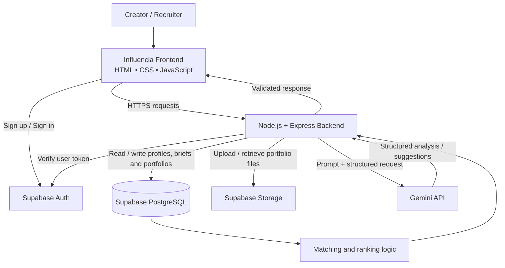

# Influencia

**AI-assisted creative talent discovery and collaboration platform**

## The problem

Agencies only discover creators when they hit 100K views or 50K followers. But what about the brilliant writer, singer, or editor struggling to get 5K? Their art walks like a vagabond—invisible, with no bridge to the industry.

Meanwhile, creative projects need a mosaic of talent (writers, voice artists, designers, animators). Right now, finding them is a fragmented mess. Recruiters can't easily explain the exact skills or style they need, and creators can't discover the right opportunities. A follower count doesn't prove if someone's work actually fits the brief. Great talent is falling through the cracks because the industry is looking at the wrong metrics.

Influencia changes that.

## Our solution

Influencia brings creators and recruiters into one platform. A recruiter can describe a project in everyday language, while a creator can explain their skills and the kind of opportunities they want. AI helps interpret those requirements and identify relevant creative profiles or collaboration opportunities.

The platform is designed to:
- Understand project requirements such as creative role, skills, language, genre, and style.
- Help creators discover relevant projects and collaborators.
- Help recruiters find creators whose stated skills and portfolio are relevant to a brief.
- Explain why a suggested match may be relevant, while leaving the final decision to people.

**AI supports discovery; it does not make hiring decisions.**

## Architecture

### Main components

| Component | Responsibility |
|---|---|
| Frontend | Landing page, login interface, AI Studio and user-facing results |
| Supabase Auth | Account creation, sign-in and user identity |
| Express backend | Secure API endpoints, validation, AI calls and business logic |
| Gemini API | Interpret a brief and return structured requirement analysis |
| Supabase PostgreSQL | Store user profiles, project briefs, skills and portfolio metadata |
| Supabase Storage | Store creator portfolio files |
| Matching logic | Compare a recruiter's requirements with creator profile data and explain relevance |

The browser must call our backend for AI requests. **Never put a Gemini secret API key in frontend HTML or JavaScript.**

## Current frontend

- `index.html` — landing page and creator discovery preview.
- `login.html` — login and signup interface (currently demo-only).
- `ai.html` — AI Studio interface for choosing Creator or Recruiter, entering a request, selecting criteria, language and project style.
- `css/` — page styles.
- `js/main.js` — landing page interactions.
- `js/auth.js` — frontend-only login/signup validation and UI interactions.
- `js/ai.js` — AI Studio form interactions and request preview.

## MVP scope

The first working MVP should demonstrate one complete flow:

1. A user chooses Creator or Recruiter and submits a request in AI Studio.
2. The frontend sends the request to the Express backend.
3. The backend validates the input and sends a carefully structured prompt to Gemini.
4. Gemini returns structured fields, for example roles, skills, language, genre and project style.
5. The backend validates the AI response and returns it to the frontend.
6. For a recruiter request, the backend compares the extracted requirements with a small set of sample creator profiles and returns ranked suggestions with clear reasons.

F

